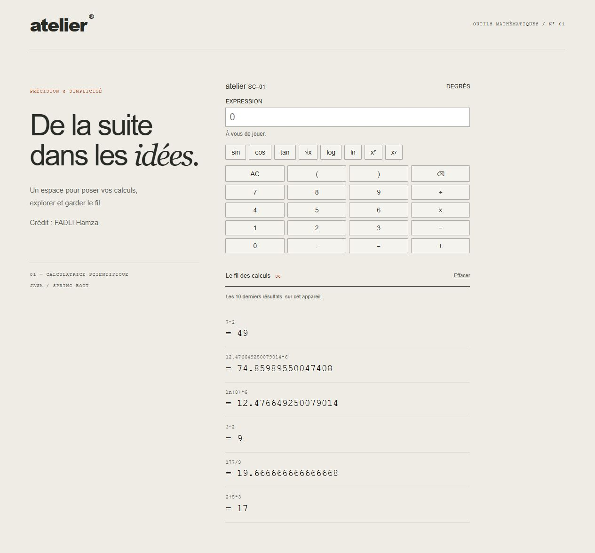

# Calculatrice scientifique

Une application web pour effectuer des calculs simples et scientifiques.

Projet de **Fadli Hamza**, développé en Java avec Spring Boot, HTML, CSS et JavaScript.



## Fonctionnalités

- Addition, soustraction, multiplication et division.
- Parenthèses, puissances et racine carrée.
- Sinus, cosinus et tangente en degrés.
- Logarithme décimal (`log`) et logarithme népérien (`ln`).
- Saisie au clavier ou avec les boutons.
- Historique des 10 derniers calculs, conservé dans le navigateur.
- Messages d’erreur pour les calculs impossibles ou les expressions incorrectes.

L’interface garde un fond crème et les textes de présentation. Le calcul se fait dans un champ de saisie classique, avec de petits boutons simples et l’historique en dessous.

## Lancer le projet

Il faut Java 17 ou supérieur et Maven 3.6 ou supérieur.

```sh
git clone https://github.com/7amzvv/calculatrice-scientifique.git
cd calculatrice-scientifique
mvn spring-boot:run
```

Ouvrir ensuite http://localhost:8080 dans le navigateur.

## Exemples

| Calcul | Résultat |
| --- | --- |
| `2+5*3` | `17` |
| `(2+5)*3` | `21` |
| `3^2` | `9` |
| `sqrt(81)` | `9` |
| `sin(30)` | environ `0.5` |
| `log(100)` | `2` |

Utiliser un point pour les nombres décimaux et `*` pour multiplier. Les fonctions s’écrivent avec des parenthèses, par exemple `sqrt(16)`.

La touche Entrée lance le calcul et Échap efface la saisie. Un clic sur un ancien résultat permet de le réutiliser.

## Organisation du code

- `service/ServiceCalculatrice.java` : analyse l’expression et effectue le calcul en respectant les priorités.
- `controller/` : reçoit l’expression envoyée par le navigateur et renvoie le résultat ou une erreur.
- `resources/static/index.html` : structure de la page.
- `resources/static/style.css` : couleurs et présentation.
- `resources/static/script.js` : boutons, appel au serveur et historique.
- `src/test/` : tests du moteur de calcul.

## Tests

```sh
mvn test
```

Le projet contient 21 tests pour vérifier les opérations, les priorités, les fonctions scientifiques et les erreurs.

## Limites

Certains résultats décimaux sont approximatifs, car le programme utilise le type `double`. Les nombres complexes et les pourcentages ne sont pas pris en charge. La longueur d’une expression est limitée à 512 caractères après suppression des espaces.
